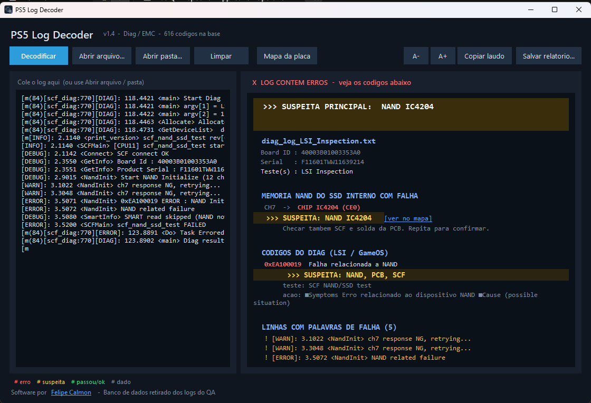
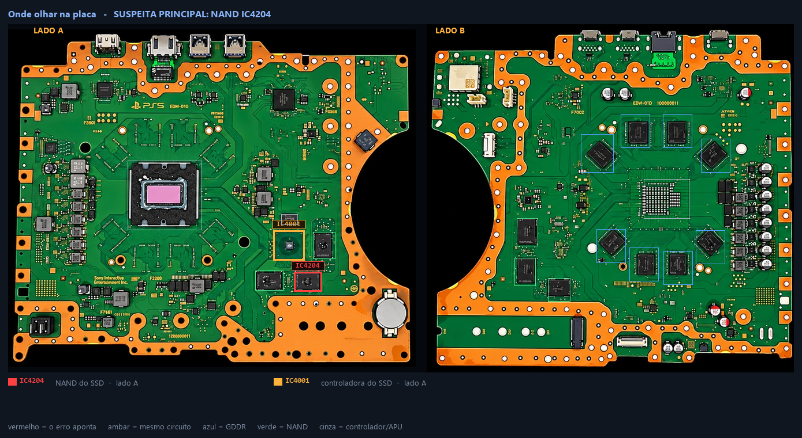

# PS5 Log Decoder

Ferramenta de bancada que lê o log de diagnóstico do PlayStation 5 e traduz, em
português, o que ele está dizendo — transformando as linhas técnicas do Diag/EMC
em um laudo direto: **o que falhou, qual peça é suspeita e o próximo passo.**

> Feito para assistência técnica. Não precisa de internet, não fala com o console
> e não tem nada de autenticação — é apenas um tradutor de log.

---

## ⬇️ Download

Baixe o programa pronto na aba **[Releases](../../releases/latest)** →
`PS5 Log Decoder.exe`. É só baixar e abrir (Windows, sem instalar nada).

---

## Recursos

- **Suspeita principal no topo.** Uma linha resume o laudo (ex.: `SUSPEITA PRINCIPAL:
  NAND IC4204`) — bate o olho e já sabe.
- **Mapa da placa (os dois lados).** Abre a foto da placa marcando GDDR, NAND,
  controlador e APU, com o chip defeituoso **em vermelho**. Abre direto no lado certo
  e tem botão para alternar LADO A (APU) / LADO B (RAM). Posições tiradas do diagrama
  oficial (GDDR) e do boardview da EDM-010 (NAND).
- **Tudo em português.** Mensagens e procedimentos traduzidos, mantendo as siglas
  técnicas (CRC, GDDR, NAND, PCIe) e os nomes de teste.
- **Base com mais de 600 códigos**, extraídos das próprias tabelas de diagnóstico do
  QA (ErrorCodeTable, DiagSummary e EMC Error Code), já com a peça/área suspeita.
- **Identifica a memória GDDR com defeito.** Ao encontrar `umc.N` no log, mostra o
  chip físico exato (ex.: `IC2201 / ref E`): mesmo `umc` sempre = GDDR ruim;
  `umc` variando = APU.
- **Identifica a NAND do SSD** (6 chips, 3 de cada lado) pelo canal
  (`ch0 … ch11`) → ex.: `CH7 → IC4204`.
- **Núcleos de CPU.** No teste de carga, mostra qual(is) CPU falharam (ex.: CPU2, CPU3).
- **Separa memória × APU** e **lista os testes que passaram** para fechar o diagnóstico.
- **Mostra a temperatura** e o **estado de energia** do EMC (quando/como o console estava).
- **Copiar laudo**, zoom de fonte (A+/A−), legenda de cores e **coletor de códigos
  desconhecidos** (para manter a base sempre atual).
- **Filtra ruído:** ignora valores de dado (`expect/actual`, CRC, endereços, handles).

## Como usar

1. Abra o `PS5 Log Decoder.exe`.
2. Cole o log na caixa, ou use **Abrir arquivo** / **Abrir pasta** (lê o pendrive inteiro).
3. O laudo aparece na hora, com o veredito no topo:
   - 🔴 contém erros  🟢 passou (PASS/Finished)  🟡 log parcial

## Requisitos

- Windows. **Não precisa instalar nada** e **não precisa de internet** — a base de
  códigos vem embutida no executável.

## Aviso do Windows na primeira vez

O `.exe` não é assinado digitalmente, então o **SmartScreen** pode mostrar
"O Windows protegeu o computador". É normal para programas pequenos. Para abrir:
clique em **Mais informações → Executar assim mesmo**.

## De onde vêm os dados

Todos os códigos e descrições são extraídos dos documentos oficiais de reparo
(tabelas de erro do QA). As traduções de área/subsistema e a regra de decisão
memória×APU seguem o que esses documentos descrevem.

## Observações

- O log precisa chegar até o ponto da falha: se o console não sobe o Diag, não há log.
- O detalhe da memória (`umc.N`) só aparece quando um teste de GDDR falha de fato.
- A tela do QA mostra só pass/fail; quem aponta o componente é o **log**.

---

*Software por Felipe Calmon — Banco de dados retirado dos logs do QA.*
